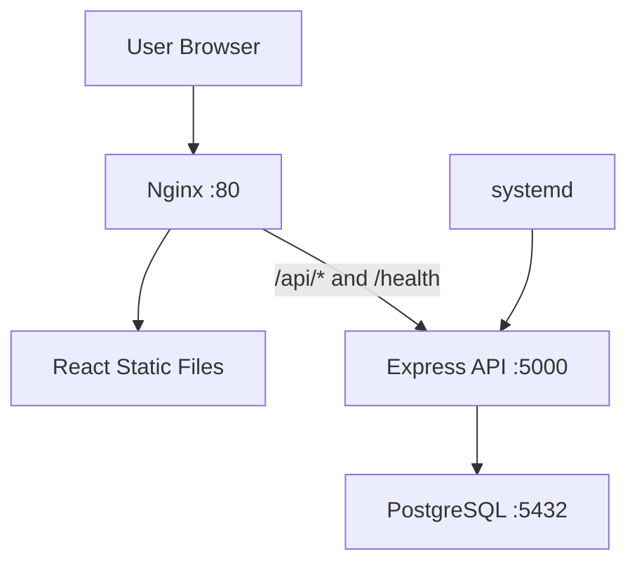

<h1 align="center">Incident Management-v2</h1>

<p align="center">
  A full-stack incident management application deployed on AWS EC2 using Ubuntu, Nginx, React, Node.js, Express, and PostgreSQL.
</p>

<p align="center">
  
  
  
  
  
  
</p>

<p align="center">
  <a href="#overview">Overview</a> •
  <a href="#features">Features</a> •
  <a href="#technology-stack">Technology Stack</a> •
  <a href="#screenshots">Screenshots</a> •
  <a href="#architecture">Architecture</a> •
  <a href="#deployment">Deployment</a>
</p>

---

## Overview

Incident Management is a hands-on cloud deployment project built to demonstrate how a full-stack application can be deployed and operated on an Ubuntu EC2 instance without using Docker.

The application provides a simple interface for creating and managing incident records. The React frontend is served by Nginx, while an Express REST API handles application requests and stores data in PostgreSQL. The backend runs as a systemd service to keep the application process managed by the server.

The deployment was completed manually with reusable Bash scripts. An optional GitHub Actions workflow is also included to demonstrate a basic CI/CD approach for an already configured EC2 instance.

## Features

- Create and manage incident records.
- Update incident statuses.
- Persist incident data in PostgreSQL.
- Serve the React frontend through Nginx.
- Route API requests through an Nginx reverse proxy.
- Run the backend as a systemd-managed service.
- Automate server setup and deployment with Bash scripts.
- Include an optional GitHub Actions workflow.

## Technology Stack

| Layer | Technology |
|---|---|
| Cloud Infrastructure | AWS EC2 |
| Operating System | Ubuntu Server 24.04 LTS |
| Frontend | React 18, Vite |
| Backend | Node.js 24, Express.js |
| Database | PostgreSQL 16 |
| Web Server | Nginx |
| Process Management | systemd |
| Automation | Bash |
| CI/CD | GitHub Actions |

## Screenshots

<p align="center"><strong>EC2 Instance Running & Initial Incident</strong></p>
<p align="center">
  
</p>

<p align="center"><strong>Installed Server Technologies</strong></p>
<p align="center">
  
</p>

<p align="center"><strong>Updated Incident Command Center</strong></p>
<p align="center">
  
</p>

<p align="center"><strong>Live Application & API Health Check</strong></p>
<p align="center">
  
</p>

<p align="center"><strong>Manual Update & Incident Persistence</strong></p>
<p align="center">
  
</p>

<p align="center"><strong>PostgreSQL Incident Records</strong></p>
<p align="center">
  
</p>

---

## Architecture



### Request Flow

1. A user accesses the application through the EC2 public IP.
2. Nginx serves the built React frontend.
3. API and health requests are forwarded to the Express backend at `127.0.0.1:5000`.
4. The backend reads and writes incident records in PostgreSQL at `127.0.0.1:5432`.
5. systemd manages the backend service.

## Deployment

### 1. Launch an EC2 Instance

Launch an instance with **Ubuntu Server 24.04 LTS**.

Configure the security group:
- Allow HTTP traffic on port `80`.
- Allow SSH on port `22` from your trusted IP address.
- Do not expose backend port `5000` or PostgreSQL port `5432` publicly.

### 2. Connect to EC2

```bash
ssh -i your-key.pem ubuntu@YOUR_EC2_PUBLIC_IP
```

### 3. Clone the Repository

```bash
git clone https://github.com/tanahmeeedsx/incident-management-2.git
cd incident-management-2
```

### 4. Install Dependencies

```bash
chmod +x scripts/*.sh
bash scripts/install-ubuntu.sh
```

### 5. Configure the Database

```bash
bash scripts/setup-database.sh
```

This script prepares the PostgreSQL database and backend environment configuration. Keep the generated `backend/.env` file private and out of Git.

### 6. Deploy the Application

```bash
bash scripts/deploy-ubuntu.sh
```

The deployment script installs application dependencies, builds the frontend, configures the backend systemd service, installs the Nginx configuration, and checks application health.

### 7. Verify the Deployment

```bash
bash scripts/check-services.sh
curl http://127.0.0.1/health
```

Then open the following address in a browser:

```text
http://YOUR_EC2_PUBLIC_IP
```

A healthy backend response should indicate that the service is running and the database is connected.

## Manual Redeployment

The application can be updated without recreating the database.

1. Make the required application changes.
2. Run the deployment script again:

   ```bash
   bash scripts/deploy-ubuntu.sh
   ```

3. Refresh the application and verify the changes.
4. Confirm that existing incident records are still available.

The submitted deployment includes the manually updated heading **Incident Command Center — Updated Manually**.

## Repository Structure

```text
incident-management-2/
├── .github/workflows/       # Optional GitHub Actions workflow
├── backend/                 # Express API and database connection
├── deploy/                  # Nginx configuration
├── docs/                    # CI/CD documentation
├── frontend/                # React application
├── incident-management-submission/  # Deployment screenshots
├── scripts/                 # Installation, setup, deploy, and checks
├── .gitignore
├── .nvmrc
└── README.md
```

## Challenges and Solutions

| Challenge | Solution |
|---|---|
| Preparing the Ubuntu server | Automated package installation and setup with Bash scripts. |
| Serving frontend and API together | Configured Nginx to serve static files and proxy API requests. |
| Keeping the backend available | Managed the Express process with systemd. |
| Protecting database credentials | Stored credentials in an untracked `backend/.env` file. |
| Preserving incident records | Used PostgreSQL for persistent storage. |
| Repeating deployment steps | Created reusable installation and deployment scripts. |

## Optional CI/CD

The repository includes `.github/workflows/deploy.yml` as an optional GitHub Actions workflow. It is designed to run validation/build steps and deploy to an already configured EC2 instance when the required repository variables and secrets are provided.

The workflow does not provision EC2 infrastructure. The deployment shown in the screenshots was performed manually.

See [GitHub Actions Documentation](docs/GITHUB_ACTIONS.md) for configuration details.

## Security Notes

- Restrict SSH access to trusted IP addresses.
- Expose application traffic through Nginx.
- Keep PostgreSQL and backend ports private.
- Never commit environment files, passwords, or SSH private keys.
- Use GitHub Secrets for sensitive CI/CD configuration.
- This educational demo does not include authentication and uses HTTP; do not use it for sensitive incident data.

## Future Improvements

- Add authentication and role-based access control.
- Introduce incident priority, assignment, and filtering.
- Configure HTTPS with SSL/TLS.
- Add monitoring, centralized logging, and alerting.
- Expand automated testing and CI/CD checks.
- Provision infrastructure using Infrastructure as Code.

## What I Learned

- Deploying a full-stack application on AWS EC2.
- Managing Ubuntu, Node.js, PostgreSQL, and Nginx.
- Configuring Nginx as a reverse proxy.
- Managing application processes with systemd.
- Handling environment variables and persistent database records.
- Automating deployment tasks with Bash.
- Understanding a basic GitHub Actions deployment workflow.

## Author

**Tanjim Ahmed (Tomal)**

[GitHub Profile](https://github.com/tanahmeeedsx)

---

<p align="center">
  Built as part of the bongoDev Student Lab — Manual Deployment of Incident Management on Ubuntu EC2.
</p>
